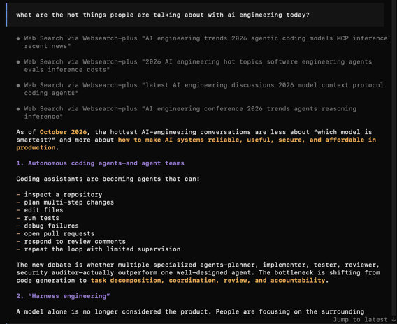

# WebSearch+

WebSearch+ is an OpenCode V2 plugin that extends the built-in `websearch` tool. It makes web search more configurable without changing how a model calls the tool.

When a model uses `websearch`, WebSearch+ chooses a provider from the user's configuration. It can rotate providers, use connected API keys, try keyless providers when available, retry another provider after a failure, and report which provider returned the result.

You can search without API keys. WebSearch+ rotates through configured keyless providers when their anonymous endpoints are available. Add API keys through `/connect` when you want more reliable access and higher provider rate limits.



---

- [Install](#install)
  - [Choose an installation source](#installation-source)
    - [Install from a local checkout](#local-checkout)
    - [Install from a Git repository](#git-repository)
  - [Start WebSearch+](#start-websearch)
  - [Connect providers and customize settings](#optional-setup)
- [What it does](#what-it-does)
- [Search API Providers](#search-api-providers)
- [Keyless and keyed search](#keyless-and-keyed-search)
- [Use WebSearch+](#use-websearch)
  - [Use a specific provider](#use-a-specific-provider)
- [Check provider status](#check-provider-status)
- [View search history](#search-history)
- [Customize plugin settings](#customize-plugin-settings)
  - [Settings reference](#settings-reference)
  - [Strategy behavior](#strategy-behavior)
- [Connect providers](#connect-providers)
- [Troubleshooting](#troubleshooting)
- [Security and compatibility](#security-and-compatibility)
- [Development](#development)
- [Custom JSON providers](#custom-json-providers)

## Install <a name="install"></a>

### Choose an installation source <a name="installation-source"></a>

Choose one:

- [Install from a local checkout](#local-checkout)
- [Install from a Git repository](#git-repository)

### Start WebSearch+ <a name="start-websearch"></a>

1. Restart OpenCode:

   ```sh
   opencode service restart
   opencode service status
   ```

2. Ask OpenCode to call `websearch_plus_status`. It should show the configured providers.

WebSearch+ uses its own defaults. You do not need to add a top-level `websearch` setting. Do not set `"websearch": false`; that removes web search completely.

### Connect providers and customize settings <a name="optional-setup"></a>

- [Connect providers](#connect-providers)
- [Customize plugin settings](#customize-plugin-settings)

### Install from a local checkout <a name="local-checkout"></a>

Run this from the repository:

```sh
cd ~/Documents/websearch-plus
npm install
```

This installs dependencies and builds `dist/index.js`.

Then add the local path to `~/.config/opencode/opencode.json`:

```jsonc
{
  "plugins": [
    "/absolute/path/to/websearch-plus"
  ]
}
```

For example:

```jsonc
{
  "plugins": [
    "/Users/name/Documents/websearch-plus"
  ]
}
```

Do not use `opencode plugin add` for a local directory.

### Install from a Git repository <a name="git-repository"></a>

Git install is an alternative to the local-path setup. Do not use both at the same time.

#### GitHub

```sh
opencode plugin add 'github:sunnymui/websearch-plus#main'
```

## What it does <a name="what-it-does"></a>

- Uses Exa, Tavily, Parallel, TinyFish, Firecrawl, Brave, Nimble, Bright Data, and ZenRows.
- Lets you add custom providers for search APIs.
- Lets you choose which providers are allowed and how it rotates between them.
- Uses connected API keys when available.
- Can try keyless provider paths when a provider supports them.
- Tries another provider after failures, timeouts, rate limits, or empty results.
- Tracks cooldowns so it does not repeatedly call a failing provider.
- Shows the provider used and any fallback attempts in the first result.
- Adds extra diagnostic commands.

## Search API Providers <a name="search-api-providers"></a>

| Provider | ID | Key setup | API key needed? |
| --- | --- | --- | --- |
| Exa | `exa` | `/connect` | No — tries a keyless request, then the next configured provider. |
| Tavily | `tavily` | `/connect` | No — tries a keyless request, then the next configured provider. |
| Parallel | `parallel` | `/connect` | No — tries a keyless request, then the next configured provider. |
| TinyFish Search | `tinyfish` | WebSearch+ entry in `/connect` | Yes |
| Firecrawl | `firecrawl` | `/connect` | No — blocked on some corporate networks. |
| Brave LLM Context | `brave` | WebSearch+ entry in `/connect` | Yes |
| Nimble Search | `nimble` | WebSearch+ entry in `/connect` | Yes |
| Bright Data | `brightdata` | WebSearch+ entry in `/connect` | Yes — Google search scraper |
| ZenRows | `zenrows` | WebSearch+ entry in `/connect` | Yes — Google search scraper |

Keyless access depends on the provider and network. Do not depend on it for production use.

Some providers require an API key. If a required key is not connected through `/connect`, WebSearch+ skips that provider and tries the next configured provider.

Bright Data and ZenRows scrape a Google search URL and return the Google results as Markdown.

## Keyless and keyed search <a name="keyless-and-keyed-search"></a>

WebSearch+ can try providers without a connected API key when their OpenCode adapter allows anonymous requests. Those providers may have small free quotas, anonymous rate limits, or no keyless access at all.

When a keyless provider rate limits a search with HTTP `429`, WebSearch+ cools it down and tries another configured provider. This gives searches a better chance to work when one free provider is busy.

Add provider keys through `/connect` when you want more reliable access, provider-specific paid quotas, or higher rate limits. When a provider has a connected key, WebSearch+ uses that key automatically.

## Use WebSearch+ <a name="use-websearch"></a>

Use OpenCode normally. Ask a question that needs current web information:

```text
Find the latest OpenCode V2 release and cite the sources.
```

To make the model search the web, say so directly:

```text
Use websearch to find the official OpenCode V2 documentation and cite the source.
```

From the command line:

```sh
opencode run --agent build \
  "Use websearch to find the official OpenCode V2 documentation and cite the source."
```

The first result includes a header like this:

```text
WebSearch+ provider: tavily
Fallbacks attempted: firecrawl (HTTP 403)
```

After a search completes, WebSearch+ also updates the built-in tool metadata. The completed tool call can show the actual provider, for example:

```text
Web Search via Tavily
```

While a search is running, OpenCode may still show `Websearch-plus` because it selects WebSearch+ before WebSearch+ chooses the underlying provider.

### Use a specific provider <a name="use-a-specific-provider"></a>

Put `provider:<id>` first in the web-search query to use only that provider:

```text
provider:exa news today
```

The directive is removed before the provider receives the search terms. It overrides the `providers` setting for that search. WebSearch+ does not use the normal rotation strategy or fall back to another provider for an overridden search. A provider that requires an API key still needs a connected key.

`provider:<id>` is an override only when it is the first term. For example, this uses the normal strategy:

```text
news today provider:exa
```

## Check provider status <a name="check-provider-status"></a>

Ask the agent to call:

```text
websearch_plus_status
```

Example output:

```text
WebSearch+ provider status

exa: success (authenticated)
parallel: success (anonymous)
firecrawl: failure (anonymous) HTTP 403 cooling until ...
brave: untried (unknown)
```

The status tool does not return API keys, queries, result content, or raw error bodies.

## View search history <a name="search-history"></a>

Ask the agent to call:

```text
websearch_plus_history
```

The history reports the 20 most recent searches, newest first. Each entry identifies the provider that returned results, its timestamp, and the provider fallback chain. It does not retain queries, result content, API keys, or raw error bodies.

```text
WebSearch+ search history

2026-10-02T19:30:00.000Z: tavily
  Attempts: firecrawl: failure (anonymous) HTTP 403 125ms, tavily: success (authenticated) 240ms
```

Use `websearch_plus_history` to identify which provider served a specific recent search. Use `websearch_plus_status` to inspect the latest health and cooldown state for every configured provider.

`anonymous` means the provider was tried without a connected API key. A failure without an HTTP status means OpenCode did not expose a numeric response status; it can indicate an unavailable keyless path, a connection failure, or another provider-adapter error. The history intentionally does not retain raw error messages or bodies.

## Customize plugin settings <a name="customize-plugin-settings"></a>

To change settings, replace the string plugin entry with an object:

```jsonc
{
  "plugins": [
    {
      "package": "/absolute/path/to/websearch-plus",
      "options": {
        "providers": ["exa", "tavily", "parallel", "firecrawl"],
        "strategy": "rotate",
        "randomProviderPreference": "has-api-key",
        "scraperConfig": {
          "brightdata": {
            "apiName": "your-bright-data-api-name"
          }
        },
        "perProviderTimeoutMs": 10000,
        "totalTimeoutMs": 30000,
        "maxResults": 8
      }
    }
  ]
}
```

Restart OpenCode after changing settings.

### Settings reference <a name="settings-reference"></a>

| Setting | Default | Description |
| --- | --- | --- |
| `providers` | Exa, Tavily, Parallel, Firecrawl | Allowed provider list and fallback pool. Remove a provider to exclude it. Provider order matters for `first` and `rotate`. |
| `strategy` | `random` | Controls how WebSearch+ uses the ordered `providers` array: `first` starts with the first provider every time; `rotate` rotates the starting provider in the defined order; `random` picks a random starting provider. All strategies use later providers only when earlier attempts fail or return no results. |
| `randomProviderPreference` | `has-api-key` | Used only with `random`: `has-api-key` tries keyed providers first; `keyless` tries keyless-capable providers first; `none` shuffles every provider together. |
| `perProviderTimeoutMs` | `10000` | Maximum time for one provider. |
| `totalTimeoutMs` | `30000` | Maximum time for the whole search. |
| `maxResults` | `8` | Maximum returned results. |
| `scraperConfig.brightdata.apiName` | `serp_api1` | Bright Data API name, sent as its `zone` value. |
| `customProviders` | — | Add your own custom providers for search APIs. See [Custom JSON providers](#custom-json-providers). |
| `retryStatuses` | `401`, `403`, `408`, `429`, `500`, `502`, `503`, `504` | HTTP statuses that trigger fallback. |
| `retryOnEmptyResults` | `true` | Try the next provider after no results. |
| `cooldowns.authFailureMs` | `900000` | Cooldown after `401` or `403`. |
| `cooldowns.rateLimitDefaultMs` | `60000` | Cooldown after `429` without `Retry-After`. |
| `cooldowns.transientFailureMs` | `30000` | Cooldown after a timeout or server error. |

### Strategy behavior <a name="strategy-behavior"></a>

| Strategy | Behavior |
| --- | --- |
| `first` | Starts every search with the first provider in the list. It tries later providers, in list order, only after a failure or empty result. |
| `rotate` | Rotates the starting provider for each search. After the starting provider, it continues through the list in order and wraps to the beginning if needed. |
| `random` | Shuffles the provider order for each search. It tries the shuffled providers in that order until one succeeds. |

`randomProviderPreference` applies only to `random`:

| Value | Behavior |
| --- | --- |
| `has-api-key` | Try providers with keys first. |
| `keyless` | Try keyless-capable providers first. A selected provider still uses its key if one exists. |
| `none` | Shuffle every provider in one group. |

## Connect providers <a name="connect-providers"></a>

Provider keys are optional. Connect a provider when you want its authenticated service, higher rate limits, paid quota, or more reliable results. When a connected provider is selected, WebSearch+ uses its key automatically.

Run this in OpenCode:

```text
/connect
```

Connect the providers you want to use. After WebSearch+ loads, Brave LLM Context and Nimble Search should also appear.

Brave, Nimble, TinyFish, Bright Data, and ZenRows are opt-in. Add their IDs to `providers` only after connecting their keys.

## Troubleshooting <a name="troubleshooting"></a>

```sh
opencode service status
tail -n 200 ~/.local/share/opencode/log/opencode.log
```

If WebSearch+ is not active:

1. Confirm the plugin path is correct.
2. Run `npm run build` in the plugin repository.
3. Restart the OpenCode service.
4. Ask the agent to call `websearch_plus_status`.
5. Ask the agent to call `websearch_plus_history` after a search to inspect the selected provider and fallback attempts.
6. Check the OpenCode log for plugin load errors.

## Security and compatibility <a name="security-and-compatibility"></a>

- WebSearch+ does not read OpenCode's SQLite database directly.
- It does not log, return, or store API keys.
- It does not store queries, result content, or raw error bodies.
- It retains the 20 most recent provider-only search histories, including timestamps, outcomes, status codes, and latency.
- Built-in provider keys remain inside OpenCode's integration layer.
- Brave and Nimble keys are used only in memory for their outbound request headers.

Brave and Nimble `/connect` entries rely on an OpenCode V2 core behavior: `IntegrationEditor.method.update` creates a missing integration. Current V2 source does this, but the behavior is not documented as a stable plugin API. Test it after each OpenCode upgrade.

## Development <a name="development"></a>

```sh
npm install
npm run typecheck
npm test
npm run build
```

See [PLAN.md](./PLAN.md) for the technical design and rollout plan.

## Custom JSON providers <a name="custom-json-providers"></a>

Use `customProviders` for a keyed JSON search API. Restart OpenCode, then connect its generated entry through `/connect`.

```jsonc
{
  "providers": ["exa", "example-search"],
  "customProviders": {
    "example-search": {
      "name": "Example Search",
      "endpoint": "https://search.example.com/v1/search",
      "method": "GET",
      "query": { "parameter": "q" },
      "auth": { "type": "bearer" },
      "results": {
        "path": "data.items",
        "url": "link",
        "title": "metadata.title",
        "content": "snippet"
      }
    }
  }
}
```

For this response:

```json
{
  "data": {
    "items": [
      {
        "link": "https://example.com/article",
        "metadata": { "title": "Example article" },
        "snippet": "A short preview."
      }
    ]
  }
}
```

WebSearch+ uses `results.path` to find `data.items`, then maps each entry to:

```json
{
  "url": "https://example.com/article",
  "title": "Example article",
  "content": "A short preview."
}
```

`method` can be `GET` or `POST`. GET adds the query as a URL parameter; POST sends `{ "<parameter>": "<query>" }` as JSON. Use `auth: { "type": "header", "name": "X-API-Key" }` for APIs that need a named key header.

`results.path` identifies the response array. `url`, `title`, and `content` identify fields on each result; dot paths are supported. `url` is required. Custom providers use the same rotation, fallback, status, and `provider:<id>` override behavior as built-in providers.
